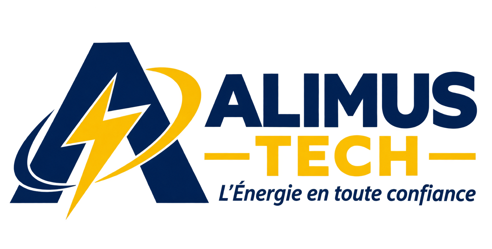

# Alimus-tech.Com
Alimus tech énergie en toute confiance 
<!DOCTYPE html>
<html lang="fr">
<head>
  <meta charset="UTF-8">
  <meta name="viewport" content="width=device-width, initial-scale=1.0">

  <title>ALIMUS-TECH | Électricité du bâtiment et solutions techniques</title>

  <meta name="description" content="ALIMUS-TECH propose des services d'installation électrique, de maintenance, de formation théorique et pratique en électricité du bâtiment et d'assistance informatique. Contactez-nous pour demander un devis.">

  <meta name="theme-color" content="#101b32">

  
</head>

<body>

  <!-- EN-TÊTE ET LOGO -->
  <header>
    

      
      ALIMUS-TECH
    

    <nav aria-label="Navigation principale">
      <a href="#accueil">Accueil</a>
      <a href="#apropos">À propos</a>
      <a href="#services">Services</a>
      <a href="#formation">Formation</a>
      <a href="#devis">Devis</a>
      <a href="#contact">Contact</a>
    </nav>
  </header>

  <main>

    <!-- PAGE D'ACCUEIL -->
    <section class="hero" id="accueil">
      <h1>Bienvenue chez ALIMUS-TECH</h1>

      

        Votre partenaire en électricité du bâtiment, maintenance
        et solutions techniques. Nous mettons notre savoir-faire
        au service de vos projets avec une approche fondée sur
        la qualité, la sécurité et le professionnalisme.
      

      <a class="button"
         href="https://wa.me/243966692973?text=Bonjour%20ALIMUS-TECH%2C%20je%20souhaite%20obtenir%20des%20informations%20sur%20vos%20services.">
        Contactez-nous
      </a>

      <a class="button button-outline" href="#devis">
        Demander un devis
      </a>
    </section>

    <!-- À PROPOS -->
    <section id="apropos">
      <h2>À propos d'ALIMUS-TECH</h2>

      

        ALIMUS-TECH est une initiative spécialisée dans les
        solutions techniques, avec un accent particulier sur
        l'électricité du bâtiment et la formation professionnelle.
        Notre objectif est d'accompagner les particuliers,
        les professionnels et les organisations dans leurs projets,
        en privilégiant la qualité du travail, la sécurité
        des installations et le développement des compétences.
      

    </section>

    <!-- NOS SERVICES -->
    <section id="services">
      <h2>Nos services</h2>

      

        ALIMUS-TECH vous accompagne dans vos travaux et projets
        techniques grâce à des prestations adaptées à vos besoins.
      

      

        <article class="card">
          <h3>Installations électriques</h3>
          

            Réalisation d'installations électriques dans les
            bâtiments, câblage, mise en place des équipements
            et organisation des circuits électriques dans le
            respect des règles de sécurité applicables.
          

        </article>

        <article class="card">
          <h3>Maintenance et dépannage</h3>
          

            Diagnostic des pannes, entretien des installations
            électriques et recherche de solutions adaptées
            afin de contribuer au bon fonctionnement
            et à la sécurité des équipements.
          

        </article>

        <article class="card" id="formation">
          <h3>Formation en électricité du bâtiment</h3>
          

            Formation théorique et pratique destinée aux débutants
            et aux personnes souhaitant renforcer leurs compétences.
            Le programme aborde les principes fondamentaux,
            les installations électriques, le câblage, les règles
            de sécurité et les exercices pratiques en électricité
            du bâtiment.
          

        </article>

        <article class="card">
          <h3>Assistance informatique</h3>
          

            Accompagnement et assistance dans l'utilisation
            des outils informatiques, selon les besoins
            et les prestations disponibles.
          

        </article>

        <article class="card">
          <h3>Conseils techniques</h3>
          

            Accompagnement dans la préparation de vos projets,
            conseils sur les travaux envisagés et orientation
            vers des solutions techniques adaptées à vos besoins.
          

        </article>

      

    </section>

    <!-- DEMANDE DE DEVIS -->
    <section id="devis">
      <h2>Demandez votre devis</h2>

      

        Vous avez un projet d'installation électrique, de maintenance
        ou de formation en électricité du bâtiment ? ALIMUS-TECH
        vous accompagne dans l'évaluation de vos besoins afin
        de préparer une proposition adaptée à votre projet.
      

      

        <h3>Parlons de votre projet</h3>

        

          Pour nous permettre d'étudier votre demande, veuillez
          préparer une description des travaux souhaités, le lieu
          d'exécution, les dimensions ou caractéristiques utiles
          et, si possible, votre budget indicatif.
        

        

          Notre équipe pourra examiner les informations transmises
          et vous communiquer les prochaines étapes pour
          l'établissement de votre devis.
        

        <a class="button"
           href="https://wa.me/243966692973?text=Bonjour%20ALIMUS-TECH%2C%20je%20souhaite%20demander%20un%20devis.%0A%0ANom%20%3A%0AType%20de%20service%20%3A%0ALieu%20du%20projet%20%3A%0ADescription%20des%20travaux%20%3A%0ABudget%20indicatif%20(si%20disponible)%20%3A">
          Envoyer une demande de devis
        </a>
      

    </section>

    <!-- CONTACT -->
    <section id="contact">
      <h2>Contactez-nous</h2>

      

        Vous avez une question ou souhaitez discuter
        de votre projet ? Contactez directement ALIMUS-TECH.
      

      

        <strong>Téléphone :</strong> +243 966 692 973
      

      <a class="button"
         href="https://wa.me/243966692973?text=Bonjour%20ALIMUS-TECH%2C%20je%20vous%20contacte%20depuis%20votre%20site%20internet.">
        Nous écrire sur WhatsApp
      </a>
    </section>

  </main>

  <!-- PIED DE PAGE -->
  <footer>
    
<strong>ALIMUS-TECH</strong>

    
Électricité du bâtiment, formation et solutions techniques.

    
&copy; 2026 ALIMUS-TECH. Tous droits réservés.

  </footer>

</body>
</html>
